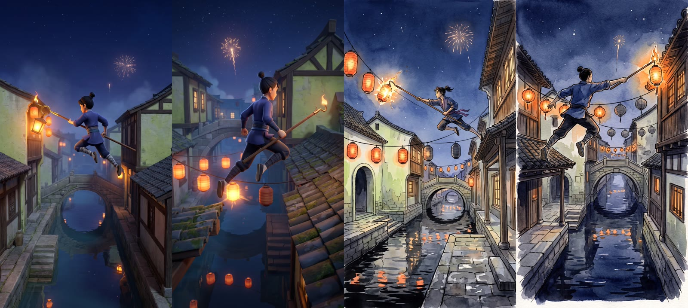
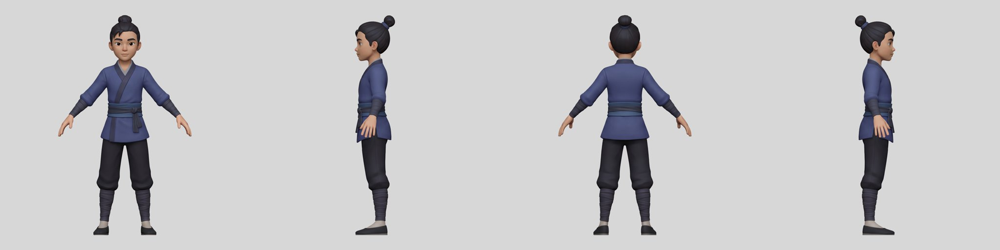
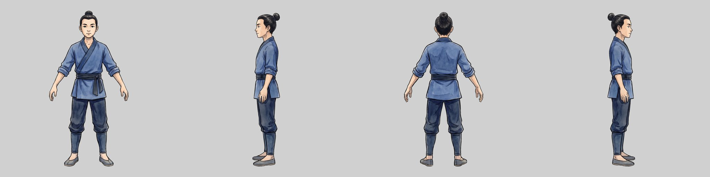
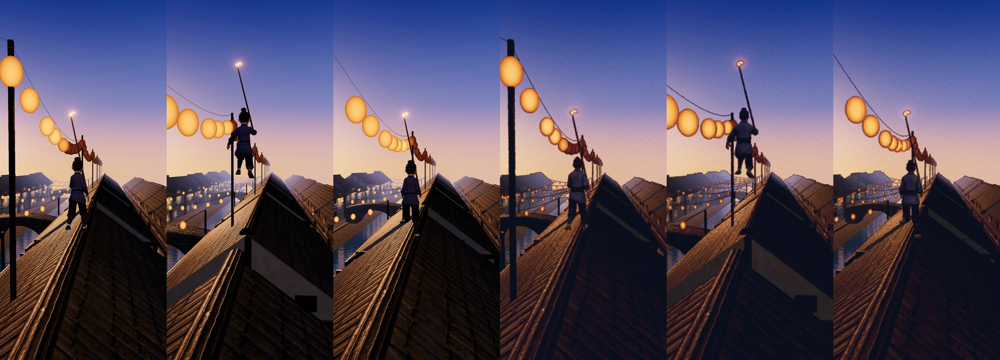

# Lamplighter

On festival night a young lamplighter races over a canal town's rooftops, quays and bridges, lighting every lantern in passing before the fireworks start.
A daily run of 30 to 90 s, the same for everyone, with a score a server can replay.

It is built for [x-gaming#7](https://github.com/imDev2023/x-gaming/issues/7) and replaces [Lantern River](https://github.com/imDev2023/lantern-river), whose rules, chunk generator and replay check it will reuse.

## Status: samples first

No game code is written until the owner approves the samples, judged against Kensei's Small Hours level and Sumiro's look.

1. **Mood stills** (done): two styles from the gameplay camera, in [samples/](samples); the owner picked stylised 2 and painted 2 and asked to carry both forward.
   
2. **The hero's 4-view sheets** (done, one per style), cut into the views image-to-3D reads.
   
   
3. **The hero in 3D** (done, both styles): lifted with Tripo H3.1 from the four views, simplified to about 24,000 triangles with its own textures, rigged with Mixamo bone names and given a run cycle and an animated jump in code; 459 KB and 652 KB compressed.
   Look at them with `npm run dev`, then `/check.html?src=/models/hero-stylised.glb&src=/models/hero-painted.glb&gap=1.2&clip=run`.
4. **The hero running over a dressed stretch of rooftops** (done, both styles), in Three.js at 390 x 844: [sample.html](sample.html) with [src/sample](src/sample).
   One 40 m stretch, tiled ahead of the runner: houses, roofs, quays, canal walls and an arched bridge built in code with Poly Haven's CC0 textures, five CC0 props dressed in clusters, the canal mirror and night sky from Lantern River.
   The hero lights each post on the route with the pole, and the light runs forward along its line to the next post; the lines across the canal are the town's own, already lit.
   The painted style adds a watercolour-and-ink screen pass over the same scene.
   Revised on 2026-11-08 at the owner's request: early evening instead of night (sun just set, warm afterglow, lanterns coming on), a jump of about a second with a crouch, a tuck and a soft landing, and a low, level chase camera so the next roof no longer slides up into the frame over each alley.
   60 fps in headless Chrome on this Mac, about 145 draw calls and 720,000 triangles (the water's mirror draws the scene twice).
   Clips: [stylised](samples/sample4-stylised.mp4) and [painted](samples/sample4-painted.mp4), 12 s each.
   

Run the samples with `npm install` and `npm run dev`, then open `/sample.html` (add `?style=painted`, `&debug` for the frame rate, `&t=6` to hold a moment).

## Tools

- `node tools/fal.ts <name> <endpoint> <arguments.json>`: one paid fal call, raw outputs to the gitignored `raw/`, logged in [fal-log.json](fal-log.json).
- `node tools/fal-usage.ts <endpoint> <start> <end>`: fal's exact charge for a time window.
- `node tools/fal-upload.ts <file>`: upload one of our own files to fal's storage as a reference image (free).
- `python3 -I tools/cut_views.py <sheet> <out_dir>`: cut a 4-view sheet into front, left, back and right views on a flat canvas (usage in its docstring).
- `tools/simplify.sh in.glb out.glb`: cut a single-atlas generated model (a Tripo output) to a phone budget, keeping its own UVs and textures.
- `tools/rig_hero.py`: rig an A-posed humanoid in headless Blender with Mixamo bone names and key a run cycle and a jump pose (usage in its docstring).
- `node tools/polyhaven.ts <asset> [1k|2k]`: download a CC0 Poly Haven texture set into `public/textures`.
- `node tools/polyhaven-model.ts <asset> [1k|2k]`: download a CC0 Poly Haven model as one compressed GLB in `public/models/props`.
- `node tools/record.mjs <url> <out.mp4> [seconds] [fps]`: record the sample page to an MP4 on a fixed clock, frame by frame.
- `check.html`: a Three.js page that loads GLBs side by side, plays a clip and frames a set view (parameters in `src/check/main.ts`).
- `tools/lowpoly_bake.py`: cut a model with several materials or overlapping UVs to a phone budget by baking in headless Blender (usage in its docstring); its cage suits props, not faces.

## Licence

Use it however you want: copy it, change it, sell it or build your own game from it, with no credit required.

- **Code:** MIT No Attribution, in [LICENSE](LICENSE).
- **Our images, video and other assets:** dedicated to the public domain under CC0 1.0, in [LICENSE-ASSETS](LICENSE-ASSETS).
- Generated assets may also carry their generator's output terms; see [CREDITS.md](CREDITS.md).
